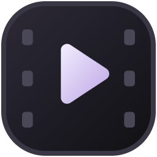
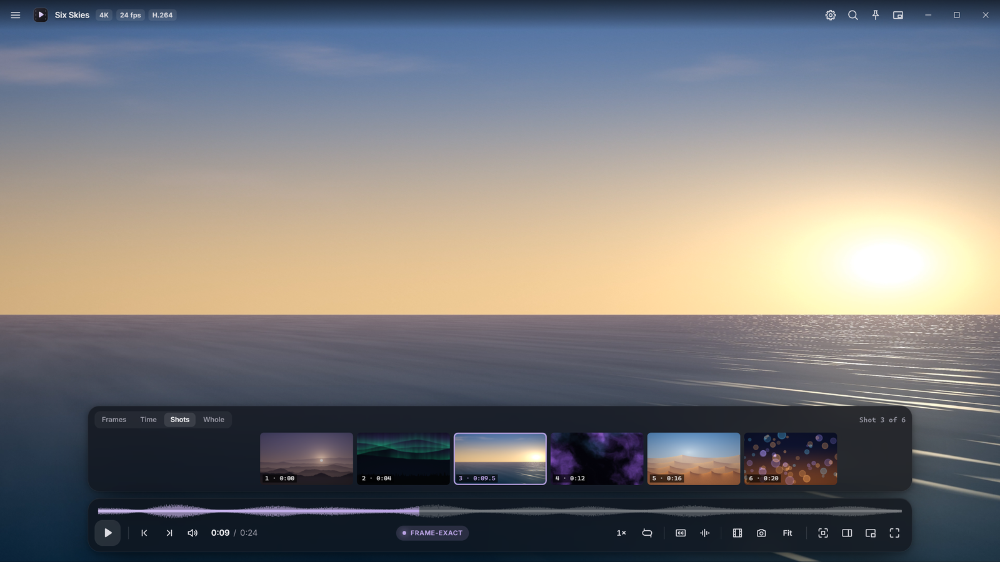
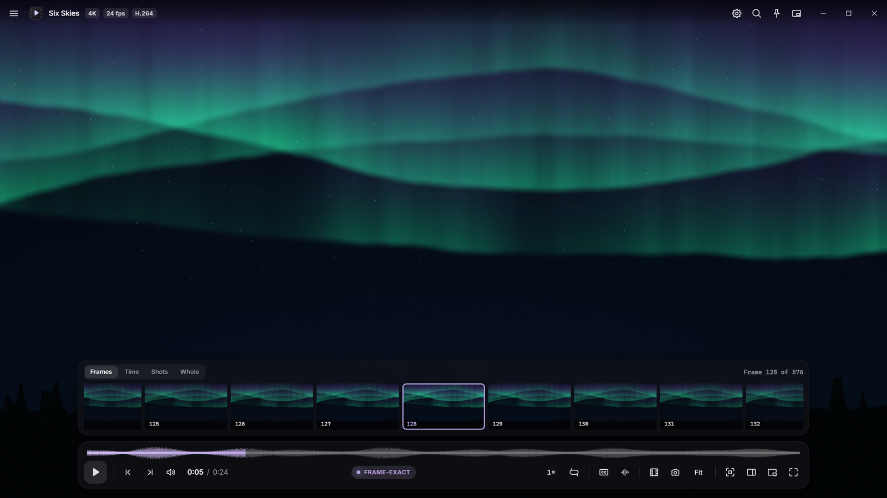
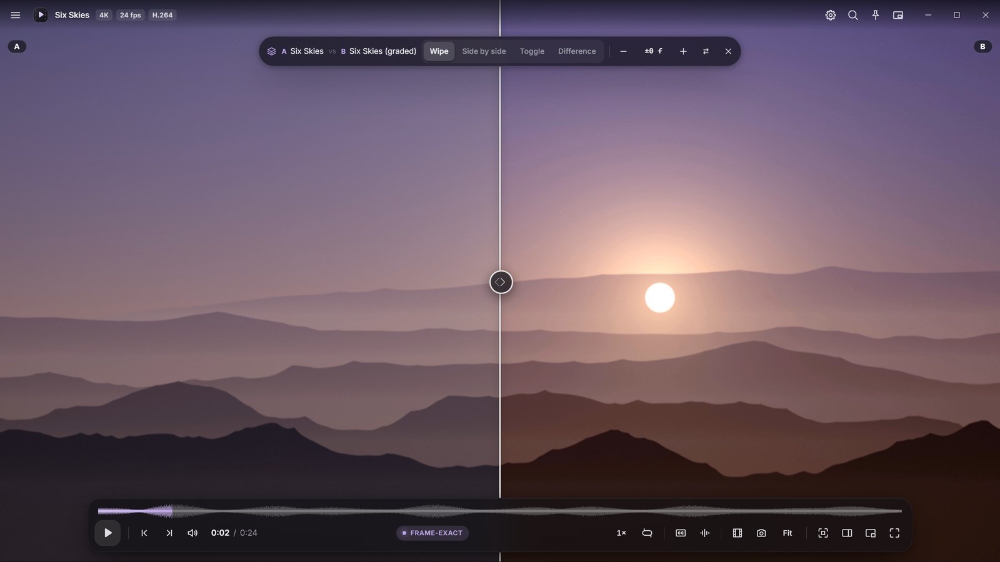
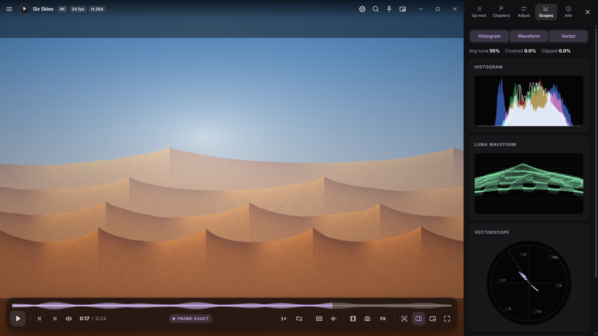
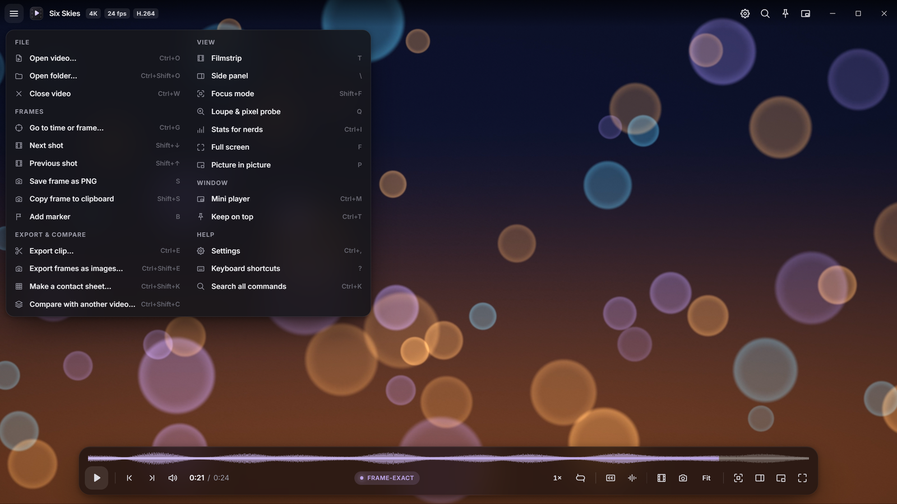

<h1 align="center">SLATE PLAYER</h1>

<strong>Every frame, exactly.</strong> A quiet, precise video player for Windows, built for 4K, HDR and genuine frame-by-frame work.

<a href="https://github.com/SPARTANAC95/slate-player/releases/latest">Download for Windows</a> &nbsp; / &nbsp; <a href="docs/GUIDE.md">User guide</a> &nbsp; / &nbsp; <a href="CHANGELOG.md">What's new</a>

   

The real interface playing <em>Six Skies</em>, an original 4K demo film rendered from code for these screenshots. No third-party footage is shown. <a href="docs/PRESENTATION.md">How the screenshots were made</a>.

## Made for looking closely

Most players are built to get you to the end of a film. Slate Player is built for the moments you want to stop on: a cut, a continuity slip, a single frame of a 4K master. It steps, scrubs and compares exactly, and keeps out of the way while you look.

- **Exact frames, instantly.** Step with `,` and `.`, hold to glide, drag the picture to scrub, or jump straight to a time, timecode or frame number. Its own frame engine (WebCodecs) keeps decoded frames around the playhead, so stepping backward through long-GOP 4K is as quick as stepping forward, and every frame number is the frame you see.
- **A filmstrip that holds still.** Press `T`. While the video plays, the middle tile shows the picture live and the pictures either side cross-fade in place, without sliding past. Show every frame, one picture per interval (½ second to 5 minutes), one per **shot**, or the whole video.
- **Shots, found for you.** Slate finds the cuts in the background and remembers them. The strip changes exactly when the picture cuts, and `Shift`+`↓` / `Shift`+`↑` land on the first frame of the next or previous shot.
- **Compare two versions.** Lock a second video to the first, frame for frame, even across frame rates. Wipe, side by side, toggle or difference, with zoom and the loupe applied to both.
- **See the picture as data.** A loupe with an exact pixel probe, zoom to 64× with crisp source pixels, an RGB histogram, luma waveform and vectorscope, and stats for nerds.
- **Focus mode.** `Shift+F` or a click of the mouse wheel: nothing on screen but the picture, and an editor's keys for frames, keyframes and seconds.
- **Keep what you find.** Save or copy a frame at full resolution, export a clip (lossless, frame-exact or GIF), every frame of a range as PNG or JPEG named by frame number, or a contact sheet.
- **Plays the files you have.** H.264, HEVC, AV1 and VP9 in MP4, MOV, MKV and WebM, 4K and HDR10, played on your GPU. Files Windows can't play (AVI, MPEG-4 Part 2, AC3/DTS/TrueHD audio and more) are re-wrapped or converted with FFmpeg, keeping the picture untouched whenever possible.
- **Everything one click away.** The ☰ menu lists every feature with its shortcut, the gear opens Settings, `Ctrl+K` searches every command, and right-click holds the everyday frame tools.

## Get watching

**[Download the Windows installer](https://github.com/SPARTANAC95/slate-player/releases/latest)**

1. Run `Slate-Player-Setup-<version>.exe` and choose to install it just for you (no admin needed) or for everyone on the PC.
2. Open a video: drag it onto the window, press `Ctrl+O`, or use **Open with → Slate Player** in File Explorer.
3. Press `T` for the filmstrip, `Shift+F` for focus mode, and open the ☰ menu for everything else.

Windows 10 or 11, **x64**. [FFmpeg](https://ffmpeg.org/) on your `PATH` is optional but recommended: exports, contact sheets, finding shots, the waveform, audio scrubbing, embedded subtitles and the automatic fixes for files Windows can't play all use it.

Prefer not to install? `Slate-Player-<version>-portable.exe` runs from anywhere, but doesn't update itself.

The builds aren't code-signed yet, so the first time Windows SmartScreen shows "Windows protected your PC": choose *More info → Run anyway*. Download only from this repository's Releases page. Each release lists SHA-256 checksums in `SHA256SUMS.txt`; compare with `Get-FileHash .\Slate-Player-Setup-<version>.exe` in PowerShell.

**Updates install themselves.** The installed app checks GitHub in the background, downloads new versions quietly and offers *Restart to update*; otherwise the update installs the next time you quit. You can switch this off in **Settings → Updates**. Version 1.0.0 predates the updater: install the latest setup file once.

## A closer look

| Every frame, exactly | Compare two versions |
|:---:|:---:|
|  |  |
| The frames around the playhead, numbered, with the one on screen outlined. | A grade against the original, locked frame for frame. Drag the divider. |
| **Scopes** | **The ☰ menu** |
|  |  |
| Histogram, waveform and vectorscope, live while you play or step. | Every feature in one place, each with its shortcut. |

Click an image to see it at full size.

## A few keys worth knowing

| Key | Does |
|---|---|
| `Space` | Play / pause |
| `,` `.` | Previous / next frame (hold to glide, `Alt` for 10) |
| `Shift`+`↓` / `Shift`+`↑` | Next / previous shot |
| `J` `K` `L` | Shuttle backward, pause, forward |
| `←` `→` | 5 seconds back / forward |
| `T` | Filmstrip |
| `Shift+F` | Focus mode |
| `I` / `O` | In / out point, then `Ctrl+E` to export |
| `S` / `Shift+S` | Save / copy the frame |
| `Q` | Loupe and pixel probe |
| `Ctrl+Shift+C` | Compare with another video |
| `Ctrl+G` | Go to a time, timecode or frame |
| `F10` / `Ctrl+K` | Main menu / search every command |
| `?` | All shortcuts |

## What it plays

| | |
|---|---|
| **Frame-exact** | H.264, HEVC, AV1 and VP9 in MP4, MOV, MKV and WebM, including fragmented MP4 and live-recorded WebM. HEVC decodes on your GPU. |
| **Plays, too** | Anything else Windows' Chromium engine decodes, with ordinary seeking. |
| **Converted on open** (FFmpeg) | AVI, MPEG-4 Part 2, AC3 / DTS / TrueHD audio, 10-bit H.264 and more: re-wrapped or converted once, cached, then played. |
| **Subtitles** | SRT, WebVTT, ASS/SSA; sidecar files load automatically, embedded tracks on demand. |
| **HDR** | HDR10 passes through to HDR displays; exports and thumbnails tone-map. |

## Built, run and checked on Windows

Version **1.2.0** was measured on a Ryzen 9 7900X3D with an RTX 2070 SUPER: a 4K file opens to its first frame in about a third of a second, a frame step takes about 5 ms, and 4K playback dropped no frames with the filmstrip open in any view, using well under a CPU core. Before release it passed the project's automated checks, which drive the real app and read frame numbers out of the pixels on screen: frame accuracy across ten formats, the filmstrip, compare, export, focus mode and more.

The [validation notes](docs/VALIDATION.md) list what was checked and the known limits. Test results describe what was checked, not a guarantee for every file or PC.

## Guides

| Looking for | Start here |
|---|---|
| Installing, the filmstrip, compare, export, settings | [User guide](docs/GUIDE.md) |
| What changed in each release | [Changelog](CHANGELOG.md) |
| What was tested and what's still limited | [Validation](docs/VALIDATION.md) |
| How the screenshots and demo film were made | [Presentation](docs/PRESENTATION.md) |
| A bug or an idea | [Issues](https://github.com/SPARTANAC95/slate-player/issues/new/choose) |

## Credits

Part of the Slate family, alongside [Slate](https://github.com/SPARTANAC95/slate) and [Slate Music](https://github.com/SPARTANAC95/slate-music). Built with Electron and Chromium's WebCodecs, electron-updater and the Inter typeface (SIL Open Font License). FFmpeg is optional and not bundled.

Created by [SPARTANAC95](https://github.com/SPARTANAC95). This repository hosts the releases, guides and issues; the source code isn't published here.
